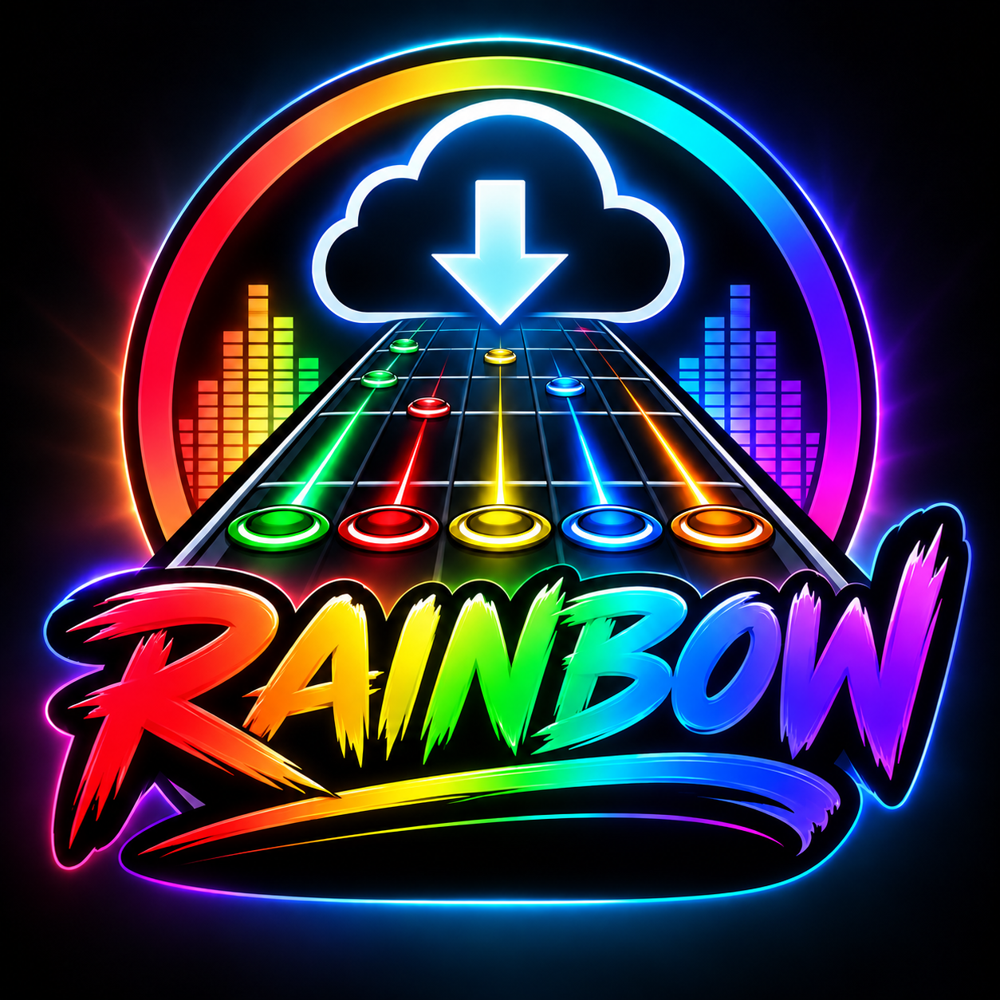

<p align="center"></p>

# Rainbow

A fast desktop app for searching and downloading Clone Hero / YARG charts from
[Chorus Encore](https://www.enchor.us). It's a lightweight alternative to
[Bridge](https://github.com/Geomitron/Bridge), written in Rust.

## Features

- **Instant search** across Encore's whole library (~95k charts). Rainbow keeps a local
  catalogue of chart metadata, so results update as you type; it only fetches what's new on
  later launches.
- **Advanced search** like Bridge's: per-field name/artist/album/genre/year/charter filters
  with *Exact* and *Exclude*, length, intensity, average/max NPS, year range, modified-after
  date, MD5 hash, track hash, and any/yes/no toggles for forced/open/tap notes, solos,
  lyrics, vocals, chart issues, video backgrounds, modcharts, roll lanes and 2x kick.
- **Instrument, difficulty and drum type** pickers.
- **Quick options:** *All songs*, *No videos*, *No broken songs* (hides charts Encore reports
  as unplayable).
- **Sortable, configurable table** (choose columns, default or compact layout).
- **Downloads** as `.sng` files or extracted **chart folders** (with `song.ini`), with or
  without video backgrounds, named by a template like `{artist} - {name} ({charter})`
  (use `/` for subfolders).
- **Bulk downloads** of selected charts, every search result, or the entire library, with
  progress, stop/resume (already-downloaded charts are skipped), and a polite delay between
  downloads.
- Respects Encore's API rate limits automatically.

## Building

Requires Rust (stable). On Windows the icon is embedded into the `.exe`.

```sh
cargo build --release
# target/release/rainbow(.exe)
```

## Data

Settings and the catalogue live in `%LOCALAPPDATA%\rainbow`. Each songs folder gets a
`.rainbow-downloaded.txt` list so re-runs skip charts you already have.

## Be nice to Encore

Encore is a free, donation-funded service. Rainbow uses the same API as Bridge, but please
keep bulk-download delays reasonable, and consider
[supporting Encore on Patreon](https://www.patreon.com/ChorusEncore701).
Rainbow is not affiliated with Chorus Encore or Bridge.

## License

MIT
