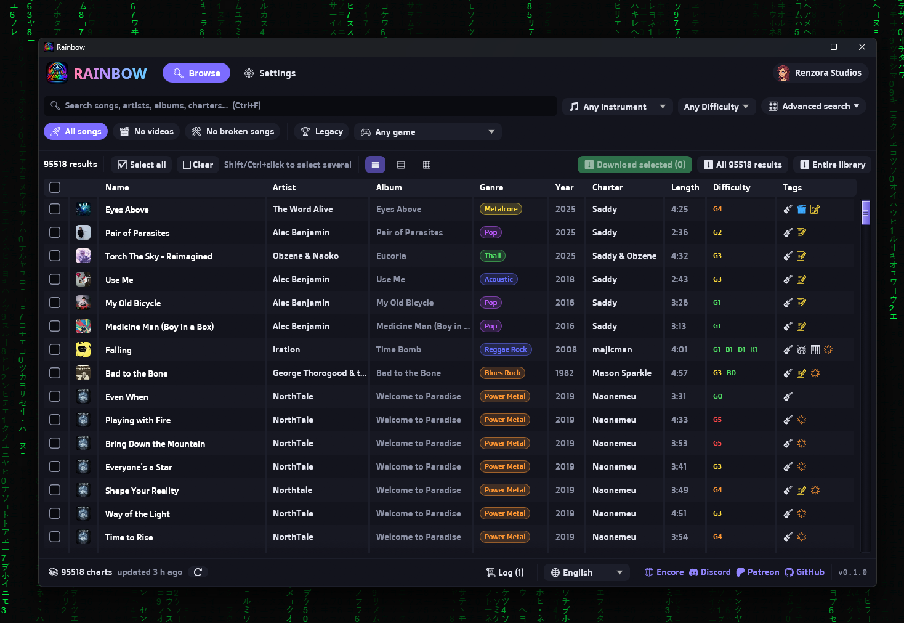

<p align="center"></p>

# Rainbow

A fast desktop app for searching and downloading Clone Hero / YARG charts from
[Chorus Encore](https://www.enchor.us). It's a lightweight alternative to
[Bridge](https://github.com/Geomitron/Bridge), written in Rust.



## Features

- **Instant search** across Encore's whole library (~95k charts). Rainbow keeps a local
  catalogue of chart metadata, so results update as you type; it only fetches what's new on
  later launches.
- **Advanced search** like Bridge's: per-field name/artist/album/genre/year/charter filters
  with *Exact* and *Exclude*, length, intensity, average/max NPS, year range, modified-after
  date, MD5 hash, track hash, and any/yes/no toggles for forced/open/tap notes, solos,
  lyrics, vocals, chart issues, video backgrounds, modcharts, roll lanes and 2x kick.
- **Instrument, difficulty and drum type** pickers.
- **Quick options:** *All songs*, *No videos*, *No broken songs* (hides charts Encore reports
  as unplayable).
- **Sortable, configurable table** (choose columns, default or compact layout).
- **Downloads** as `.sng` files or extracted **chart folders** (with `song.ini`), with or
  without video backgrounds, named by a template like `{artist} - {name} ({charter})`
  (use `/` for subfolders).
- **Bulk downloads** of selected charts, every search result, or the entire library, with
  progress, stop/resume (already-downloaded charts are skipped), and a polite delay between
  downloads.
- **Rock Band song conversion** (no Nautilus needed): drop Rock Band CON files (e.g. from
  RhythmVerse) onto the window, or put them in your songs folder, and Rainbow turns them into
  Clone Hero charts: `song.ini` from `songs.dta`, `notes.mid`, `album.png`, and the multitrack
  audio split into per-instrument Ogg Vorbis stems. Encrypted official DLC can't be converted.
- **Chart preview**: watch any chart's notes fall down a highway before downloading it.
- **Automatic .zip extraction** for charts downloaded from other sites.
- **Accessibility**: a choice of fonts (including Atkinson Hyperlegible, Lexend and
  OpenDyslexic), colour-blind safe colours, a high-contrast theme, reduce motion, full
  keyboard control (press F1 for the list) and screen reader support through AccessKit.
- Clickable artists, albums, charters, games, difficulties and more, a Legacy filter for the
  official Guitar Hero / Rock Band charts, album art, and several colour themes.
- Respects Encore's API rate limits automatically.

## Building

Requires Rust (stable). On Windows the icon is embedded into the `.exe`.

```sh
cargo build --release
# target/release/rainbow(.exe)
```

## Translations

Rainbow follows your system language and has a language picker in the status bar. It ships
with English plus Spanish, Brazilian Portuguese, French, German, Italian, Dutch, Polish,
Swedish, Czech, Turkish, Russian, Ukrainian, Indonesian, Vietnamese, Japanese, Korean and
Simplified and Traditional Chinese.

Each language is one file in `assets/lang/` that maps the English text to its translation.
To fix a translation or add a language without rebuilding, put a file in the `lang` folder
inside Rainbow's data folder (see [Data](#data)); copy `assets/lang/template.json` to start a
new one, and name the file after the language code, e.g. `pt-PT.json`. For contributors:

- `python tools/extract_strings.py` refreshes `template.json` after code changes.
- `python tools/check_translations.py` checks every language for missing strings and
  broken `{placeholders}`.
- `python tools/subset_cjk.py <fonts folder>` rebuilds the small Korean and Chinese fonts
  after their translations change.

Right-to-left and complex scripts (Arabic, Hebrew, Hindi, Thai) aren't supported yet,
because the UI library can't lay them out correctly.

## Fonts

Rainbow bundles its fonts, all under the SIL Open Font License (see `assets/fonts`). The
default, Rainbow Rounded, is Doppio One by Sorkin Type with its ligature table removed.

## Data

Rainbow keeps its settings, chart catalogue and language overrides in each system's usual
place, and album covers in the system's cache folder:

| | Data | Cover cache |
|---|---|---|
| Windows | `%LOCALAPPDATA%\rainbow` | `%LOCALAPPDATA%\rainbow\covers` |
| macOS | `~/Library/Application Support/Rainbow` | `~/Library/Caches/Rainbow/covers` |
| Linux | `~/.local/share/rainbow` (`$XDG_DATA_HOME`) | `~/.cache/rainbow/covers` (`$XDG_CACHE_HOME`) |

Each songs folder also gets a `.rainbow-downloaded.txt` list, so re-runs skip charts you
already have.

## Be nice to Encore

Encore is a free, donation-funded service. Rainbow uses the same API as Bridge, but please
keep bulk-download delays reasonable, and consider
[supporting Encore on Patreon](https://www.patreon.com/cw/ChorusEncore701?l=en-GB).
Questions about Encore itself? Join the [Encore Discord](https://discord.gg/cqaUXGm).
Rainbow is not affiliated with Chorus Encore or Bridge.

## Credits

Created by [Renzora Studios](https://github.com/renzora).

## License

Licensed under either of

- Apache License, Version 2.0 ([LICENSE-APACHE](LICENSE-APACHE) or
  <https://www.apache.org/licenses/LICENSE-2.0>)
- MIT license ([LICENSE-MIT](LICENSE-MIT) or <https://opensource.org/licenses/MIT>)

at your option.

Unless you explicitly state otherwise, any contribution intentionally submitted for
inclusion in the work by you, as defined in the Apache-2.0 license, shall be dual licensed
as above, without any additional terms or conditions.

The bundled fonts in `assets/fonts` keep their own SIL Open Font License (see the `OFL*.txt`
files there).
